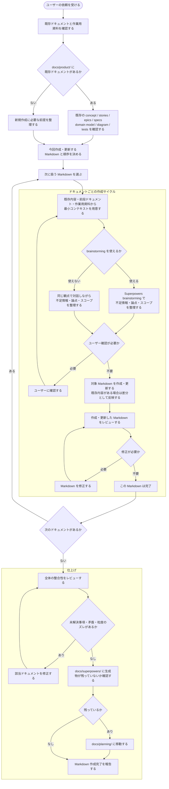
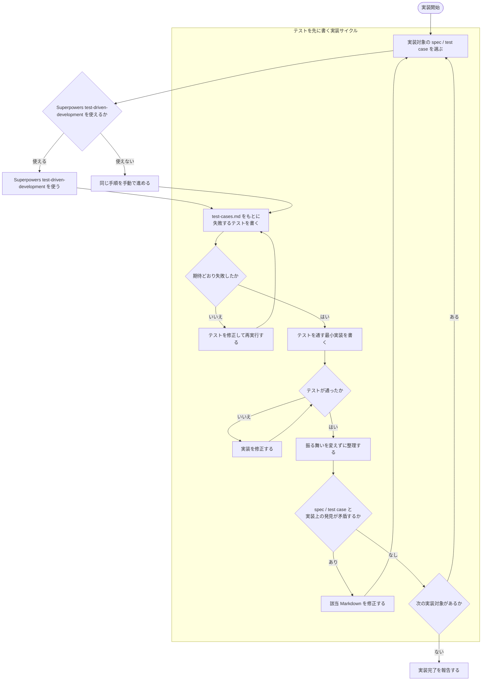

# AIDD Flow を進める

## 概要

AI と対話しながら開発内容を具体化し、その過程で得た意図、要求、仕様、設計、検証観点を、人が確認しやすい正本ドキュメントとして作成・更新する。その後、テストケースを起点に、テストを先に書いてから実装する。

`docs/product/` に、コンセプト、ユーザーストーリー、Epic、Spec、ドメインモデル、ダイアグラム、テスト方針、テストケースを作成・更新する。

## 制約事項

Superpowers のスキル実行時に生成される日付つきの `docs/superpowers/specs` と `docs/superpowers/plans` はプロダクトドキュメントの正本にはしない。

Superpowers 由来の作業用ドキュメントは以下のように保存する。

```text
docs/planning/
  specs/
    YYYY-MM-DD-<topic>-design.md
  plans/
    YYYY-MM-DD-<topic>.md
```

`docs/planning/` の資料は、`docs/product/` の正本ドキュメントを作成・更新するための材料として参照する。

この skill の処理が終わる前に、Superpowers が生成したドキュメントがデフォルトの `docs/superpowers/` 配下に残っていないか確認する。残っている場合は、以下の対応で所定の場所へ移動する。

```text
docs/superpowers/specs/
  -> docs/planning/specs/

docs/superpowers/plans/
  -> docs/planning/plans/
```

移動後は、`docs/superpowers/` 配下に今回の作業で生成された specs/plans が残っていないことを確認し、何かしらのファイルが残っている場合は報告する。

## ワークフロー

この skill は、正本 Markdown を作成・更新する段階と、必要に応じてテストを先に書いて実装する段階に分けて進める。

### Markdown 作成ワークフロー

新規プロジェクトでは正本 Markdown を一から作成し、既存プロジェクトに機能追加する場合は `docs/product/` の既存内容を読み取ったうえで、追加・変更が必要な Markdown だけを更新する。



Superpowers の `brainstorming` が使える場合はそれを使い、前段ドキュメント、既存の `docs/product/`、作業用資料から不足情報、論点、スコープを整理する。
Superpowers の `brainstorming` が使えない場合は同じ観点を通常の対話で確認し、必要なヒアリングを行ってから対象 Markdown に反映する。

単体レビューでは、前段ドキュメントとのつながり、目的との整合性、粒度、MECEかどうか、未解決事項、プレースホルダー、リンク、用語の一貫性を確認する。

### テスト先行の実装ワークフロー

Markdown 作成ワークフローが完了し、実装まで行う場合は、以下のプロセスで進める。



この開発フローでは、実装に入る前に `test-plan.md` で検証方針を整理し、`test-cases.md` で具体的なテストケースを定義する。

TDD を実施する際は、`test-plan.md` をもとに作成した `test-cases.md` と、対象機能の Markdown を参照する。Superpowers の `test-driven-development` が使える場合は、それらの内容を渡して進める。
Superpowers の `test-driven-development` が使えない場合も同じ考え方で、`test-cases.md` をもとに失敗するテストを書くところから始める。

失敗理由が期待どおりであることを確認してから、最小限の実装を書く。テストが通った後だけ、振る舞いを変えずに整理する。テストケースや対象機能の Markdown と実装中の発見が矛盾する場合は、実装を進める前に該当 Markdown に戻って修正する。

## コンテキスト分離によるドキュメント作成

サブエージェントや別セッションを使える場合は、並列化ではなく品質低下を避けるために、図の「ドキュメントごとの作成サイクル」を Markdown 単位で分離し、各 Markdown に必要な情報だけを渡して実行する。

親エージェントは以下を担当する。

- ユーザーの依頼を受け、既存ドキュメントと作業用資料を確認する。
- `docs/product/` に既存ドキュメントがある場合は、今回の変更が影響する範囲を確認する。
- 作成・更新するドキュメントを決める。
- 次に扱う Markdown ごとに、前段ドキュメントと既存資料から最小コンテキストを用意する。
- 子エージェントに、対象 Markdown の作成・更新と単体レビューを依頼する。
- 子エージェントからユーザー確認が必要な事項を受け取り、質問を整理してユーザーに確認する。
- ユーザー回答を対象 Markdown の作成サイクルに戻す。
- すべての Markdown 作成後に、全体の整合性をレビューし、問題があれば該当の Markdown の作成からやり直す。
- 最後に `docs/superpowers/` の残存生成物を確認し、必要に応じて `docs/planning/` へ移動する。

子エージェントは以下を担当する。

- 関連する最小限のコンテキストだけを受け取る。
- 対象 Markdown を作る直前に必要に応じて brainstorming、または同等の確認を行う。
- 重要な不足情報を推測で埋めず、ユーザー確認が必要な事項として親エージェントへ返す。
- ユーザー確認が不要になったら、対象 Markdown を作成・更新する。
- 作成・更新した Markdown をレビューし、必要であれば修正してから完了とする。
- 関係ないドキュメントを編集しない。

## デフォルト構成

```text
docs/
  product/
    concept.md
    user-stories.md
    epics/
      <epic-name>.md
    specs/
      <spec-name>.md
    domain-model.md
    diagram.md
    test-plan.md
    test-cases.md

  planning/
    specs/
      YYYY-MM-DD-<topic>-design.md
    plans/
      YYYY-MM-DD-<topic>.md
```

## 各ドキュメントの責務

`concept.md` には、目的、対象ユーザー、解決したい課題、ゴール、非ゴール、成功条件を書く。

`user-stories.md` には、ペルソナとユーザーストーリーを書く。

`epics/*.md` には、ユーザーストーリーを開発単位へまとめた内容を書く。機能要求、非機能要求、設計制約、派生する specs、受け入れ条件、対象外を含める。

`specs/*.md` には、Epic の要求を具体仕様として書く。元になった要求、フィールド/パラメーター、振る舞い、検証、エラー、例を含める。

`domain-model.md` には、中核概念、関係、不変条件、ライフサイクル、ユーザーが触る概念、内部概念を書く。必要に応じてドメインモデル図も置く。

`diagram.md` には、システムコンテキスト図、コンポーネント図、クラス図、シーケンス図、データフロー図、データモデル / 永続化図、エラー時フローなど、UML やシステム設計で使う図を書く。

`test-plan.md` には、テスト方針、テストレベル、検証対象、外部依存の扱い、非ゴールを書く。

`test-cases.md` には、テストケースの一覧を書く。各テストケースには、テストケース名、対応する関数名やテスト名、対象仕様、入力パラメーター、実行する内容、期待結果を書く。実行コマンドは必須にしない。

## テンプレート

新しいファイルを作るときは `assets/templates/` のテンプレートを使う。

- `concept.md`
- `user-stories.md`
- `epic.md`
- `spec.md`
- `domain-model.md`
- `diagram.md`
- `test-plan.md`
- `test-cases.md`

## レビュー観点

完了前に以下を確認する。

- 正本ドキュメントが `docs/product/` に置かれている。
- 作業用資料が `docs/planning/` に置かれている。
- 各 spec が元になった Epic の要求へ紐づいている。
- ドメイン概念とダイアグラム上の用語が一致している。
- 未解決事項が明示されている。
- `未解決事項` として意図的に残したもの以外に、プレースホルダーが残っていない。
- 実装まで行った場合、テストを先に書き、期待どおり失敗することを確認してから実装している。
- 実装まで行った場合、テストケース、spec、実装の対応関係が崩れていない。
