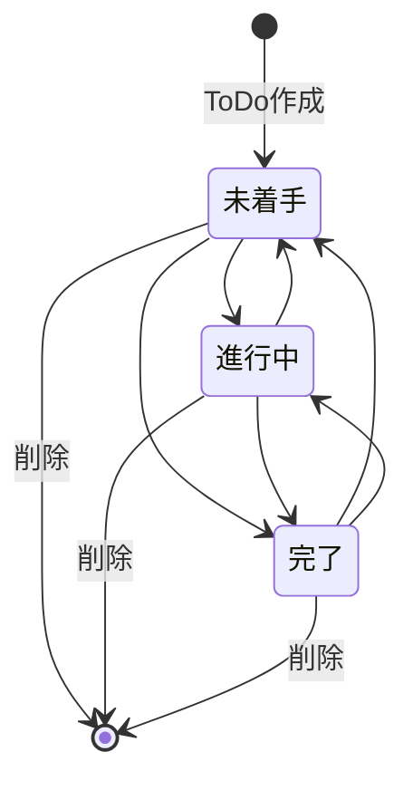

# ドメインモデル

## 中核概念

### ToDo

利用者が実行したい1件の作業。タイトル、ステータス、作成日時を持つ。

### ステータス

ToDoの進捗を表す値。

| 内部値 | 表示名 | 意味 |
| --- | --- | --- |
| `NOT_STARTED` | 未着手 | まだ作業を開始していない |
| `IN_PROGRESS` | 進行中 | 現在作業している |
| `COMPLETED` | 完了 | 作業が完了した |

## 関係

各ToDoは必ず1つのステータスを持つ。ログイン機能がないため、利用者エンティティとの関連は持たない。

## 不変条件

- ToDoのタイトルは1文字以上200文字以下である。
- ToDoのタイトルは空白だけではない。
- ToDoのステータスは定義済みの3値のいずれかである。
- 新規ToDoのステータスは未着手である。
- 作成日時はToDo作成時に設定される。

## ライフサイクル

1. 利用者がタイトルを入力し、ToDoを作成する。
2. ToDoは未着手として保存される。
3. 利用者が必要に応じて任意のステータスへ変更する。
4. 不要になったToDoを削除する。

ステータス変更順序には制限を設けず、3状態の間を任意に遷移できる。

## ユーザーが触る概念

- ToDoタイトル
- 未着手、進行中、完了という表示ステータス
- ToDo一覧

## 内部概念

- ステータス内部値
- ToDoの主キー
- 作成日時

## 図

